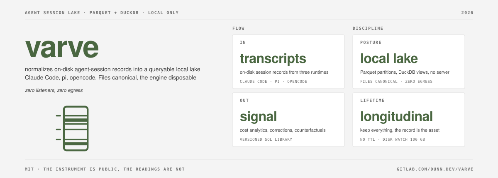
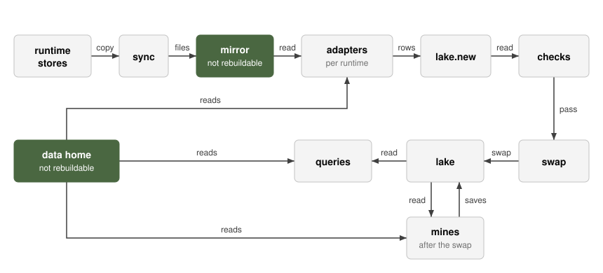
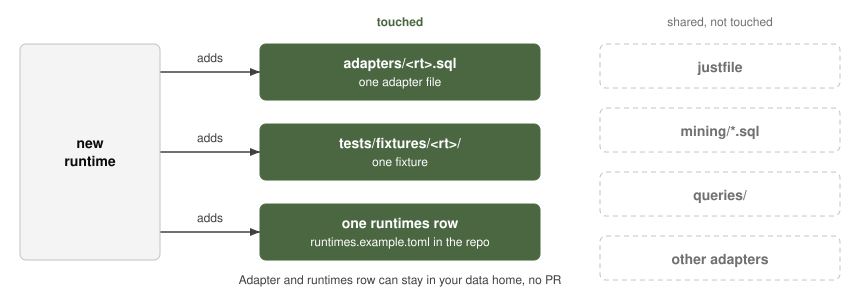
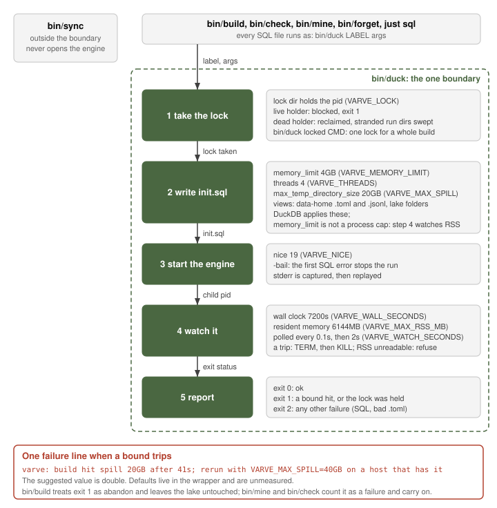

# varve

A varve is one annual sediment layer in a glacial lake. Scientists read the
sequence to reconstruct past climate. varve is that instrument for coding-agent
sessions: a local lake of everything your agents did, in readable layers, mined
for signal.

It normalizes the on-disk session records of Claude Code, pi and opencode into
Parquet partitions and queries them with DuckDB. Files are canonical; the engine
is disposable. It runs no daemon, opens no port and sends nothing off the
machine.

The core answers efficiency questions from history: cost, cache use, dispatch
shape. Layers over the same four tables ask whether corrections land once and
hold, when context engineering has saturated for a team, and whether the record
can serve as simulation evidence and leak-free benchmark material.

## Architecture

`just sync` copies sources into a mirror. `just build` rebuilds the lake from it, checks it, swaps it in, then runs the mines (ADR-0008 to ADR-0010).

Three primitives: files, SQL files, one runner (`bin/duck`). Everything extensible is a SQL file, run in a fixed order: adapters, checks, swap, mines.

| Kind | Reads | Rows become |
|------|-------|-------------|
| adapter | the mirror | the four tables |
| check | the tables | failures |
| mine | the tables | a saved table |
| query | the tables | printed output |

The mirror and your data home cannot be rebuilt.

A new runtime touches three files.

One wrapper bounds every DuckDB process.

## Layout

| Path | What |
|------|------|
| `adapters/` | One normalizer per runtime (Claude Code, pi, opencode), plus example pricing and attribution tables |
| `sql/` | Shared adapter prelude and the written meaning of every column (`record.sql`) |
| `queries/` | The versioned SQL query library |
| `mining/` | Example mines (one detector per file), example patterns and taxonomy, review rendering, year-in-review stats and their queries |
| `docs/` | PRD, ADRs (`adr/`), RFCs (`rfc/`), query index |
| `checks/` | Checks that run on every build |
| `tests/` | Synthetic three-runtime fixtures and expected output for `just test` |
| `bin/` | The runner (`duck`) and the scripts behind `sync`, `build`, `check`, `forget` and `mine` |
| `justfile` | `sync`, `build`, `check`, `forget`, `mine`, `review`, `interventions`, `stats`, `sql`, `lint`, `test`, `disk` |

`mise install` provisions the pinned `duckdb`, `just` and `yq` from `mise.toml`.

## Mining

The repo's `mining/` holds example mines, one detector per file. To use them, copy
`mining/[0-9]*.sql` into `mining/` in your data home, copy `patterns.example.toml`
and `divergence_taxonomy.example.toml` there without the `.example`, and tune the
patterns. `just mine` runs your files in filename order. Each saves one table under
the lake: `NN-<table>[.<part>].sql` leaves its rows in `mine_out` and lands in
`<table>/<part>.parquet`. A mine's version is the hash of its file. A failing mine
keeps its last good file and the others still run. `just review` renders the
adjudication document from the mined tables.

Lake data never lives in this repo. It lands in `~/.local/share/varve/`, and so
does your own data: attribution rules, adjudications, worksheets (ADR-0004). The
instrument is public; the readings are not.

## Status

The lake, correction mining and cost analytics are in use. The pi adapter is the
least exercised and states its own status in `adapters/pi.sql`.

## Contributing

GitLab is canonical; GitHub is a push mirror. A pull request on the mirror is
ported to GitLab with authorship kept. Adapters for new runtimes are welcome and
should follow ADR-0009.
